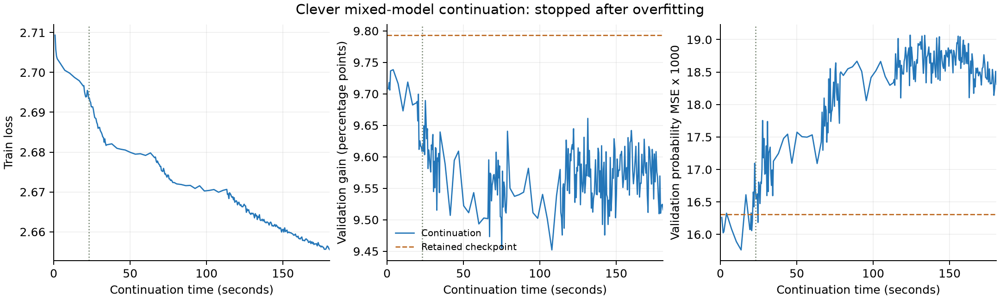

# Clever GPU 试训与过拟合验证（2026-11-27）

混合模型保留为后续基线。三个随机种子的对照中，按 1v1/多人分开的专家模型没有显示明确优势；后续继续训练出现过拟合，已提前停止，未替换原有最佳权重。

## 数据与环境

- RTX 4060 Laptop GPU（8 GB），驱动 595.97；Python 3.11.5、NumPy 2.4.6、PyTorch 2.14.1+cu130，CUDA AMP 实际运行。
- 正式批次加补充包中的四个子数据集，共 16,724 个决策、191,182 个候选动作、4,000 场战斗；每动作和基线均 256 次配对原版续战，共 53,223,936 次续战。
- 训练 13,392、验证 1,666、测试 1,666 个决策。归档只纳入已完成且 SHA-256 匹配的分片；核对胜负与配对收益，跨分区名字重叠为零。
- 名字、后缀、seed、PBB 模型分数及旧启发式分数均不入模。属性、技能熟练度和当前状态为输入。pilot 未纳入。
- 使用机制摘要网络，情景 1318 维、动作 327 维，479106 个参数；全部实体参与池化，包含召唤物和死亡实体。

## 混合与分开训练对照

固定三个种子 20261127、20261128、20261129，训练混合、1v1 专家、多人专家各三次。每模型用各自验证集选检查点，专家按原始队伍人数路由。下表为三个种子的平均单步收益，单位为百分点。

| 场景 | 测试决策/战斗数 | 混合模型 | 分开专家 |
|---|---:|---:|---:|
| 1v1 | 217/55 | +7.75 | +7.65 |
| 2v2 | 812/203 | +10.53 | +10.65 |
| 3v3 | 129/15 | +6.40 | +6.46 |
| 4v4 | 508/127 | +8.87 | +8.89 |
| all | 1666/400 | +9.34 | +9.40 |

总体专家减混合为 +0.06 个百分点，按战斗重采样的近似 95% 区间为 [-0.06, +0.17]，包含零。当前没有足够证据增加专家分流复杂度；专家权重已删除，仅保留对照记录。

## 继续训练与停止依据

以验证收益最高的混合检查点（seed 20261129，第 15 轮）继续训练。原检查点没有优化器状态，因此沿用权重和标准化参数，以新 AdamW、初始学习率 0.0001 热重启，设置最长 10 分钟和按时间余弦降学习率。

实际继续训练 180.7 秒、236 轮，记录到全局第 251 轮后立即终止。

| 指标 | 续训前/首轮 | 停止前末轮 |
|---|---:|---:|
| 训练组合损失 | 2.709354（首轮） | 2.655450 |
| 验证集单步收益 | +9.79 pp | +9.52 pp |
| 验证胜率回归 MSE | 0.016310 | 0.018310 |

训练损失下降，但验证收益与回归误差同时恶化，说明这批数据上的继续拟合已不能带来泛化收益。续训产生的最高验证收益也未超过起点。逐张量核验确认，保留最佳模型与原第 15 轮权重完全一致。

新增自动停止条件：记录至少十轮后，最近五轮平均训练损失较开头五轮降低超过 0.002、验证 MSE 高于历史最低值 5% 以上、验证动作收益低于最佳值 0.1 个百分点，三项同时满足即停止。使用此次真实日志回放，该规则会在全局第 33 轮、约 22.9 秒时触发。时间预算作为最长上限，不再覆盖过拟合停止。

## 最佳权重重新验证

独立运行只评估入口，梯度更新为零。既有留出测试集平均单步收益 +9.33 个百分点，按战斗重采样的近似 95% 区间为 [+8.84, +9.86]；相对均匀候选为 +9.85，相对仅按训练集技能收益先验选择为 +4.41 个百分点。

| 场景 | 最佳混合模型单步收益 |
|---|---:|
| 1v1 | +7.57 pp |
| 2v2 | +10.47 pp |
| 3v3 | +6.52 pp |
| 4v4 | +8.99 pp |

该指标只表示选当前一步、之后双方按原版续战时，相对原版基线的收益；不能解读为完整学习策略的对战胜率或相对现有 Clever 的胜率提升。测试集此前已用于模型对照，是既有留出集，不是此次新采集的独立终验数据。

## 后续方向与限制

继续保留带验证早停的混合模型。现阶段应优先增加新的独立战斗、困难状态和机制覆盖，补齐 4v4 验证样本以及普通 1v1、3v3 的测试覆盖，再考虑增加训练时长。3v3 测试只有 15 场战斗，不能把 129 步视为 129 个独立场景。

当前 Python 摘要编码器不是生产 Rust encoder-v1；其他实体仍是回合边界状态，部分实体关系和状态细节被池化简化。归档 engine_commit 为 unknown，无法确认精确引擎提交。置信区间按战斗重采样，未覆盖全部共享名字、随机流与编码误差。名单字符和队伍后缀本身不构成需要分开训练的依据。

第 15 轮最佳混合权重现已接入 Clever 决策并随引擎发布，参数及导出说明见 [模型目录](../../crates/tswn_core/models/clever-mixed-v1/README.md)。网页默认原版，选择 Clever 学习模型启用；未覆盖专属技能回退旧搜索。完整策略的实战收益仍需另行评估。RC 的第三句成长台词为“其实我不太欣赏的来小”，与原两句等概率抽取，已通过实际 WASM 战斗触发验证。

## 复现与本地文件

- 训练入口与参数：[脚本说明](../../scripts/clever_training/README.md)。
- 核心测试 1028 项、no_debug RC 测试 12 项通过；nightly 格式检查通过。
- 本地输出根目录：`crates/nn_handoff/clever-gpu-trial-20261127/`。
- 唯一推荐权重：`mixed-best.pt`；原三个混合检查点保留作基线，专家权重为零。
- 完整数值结果：`results.json`；模型校验：`verified-best/metrics.json`；过拟合记录：`mixed-10min/history.json` 与 `stop_and_verification.json`。
- 数据缓存、SHA-256 审计、环境、GPU 采样和运行脚本快照一并保留；原始输入归档未改写。
